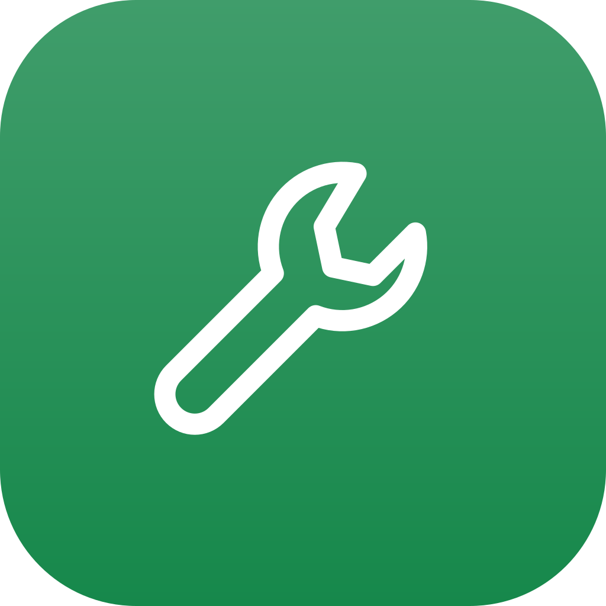
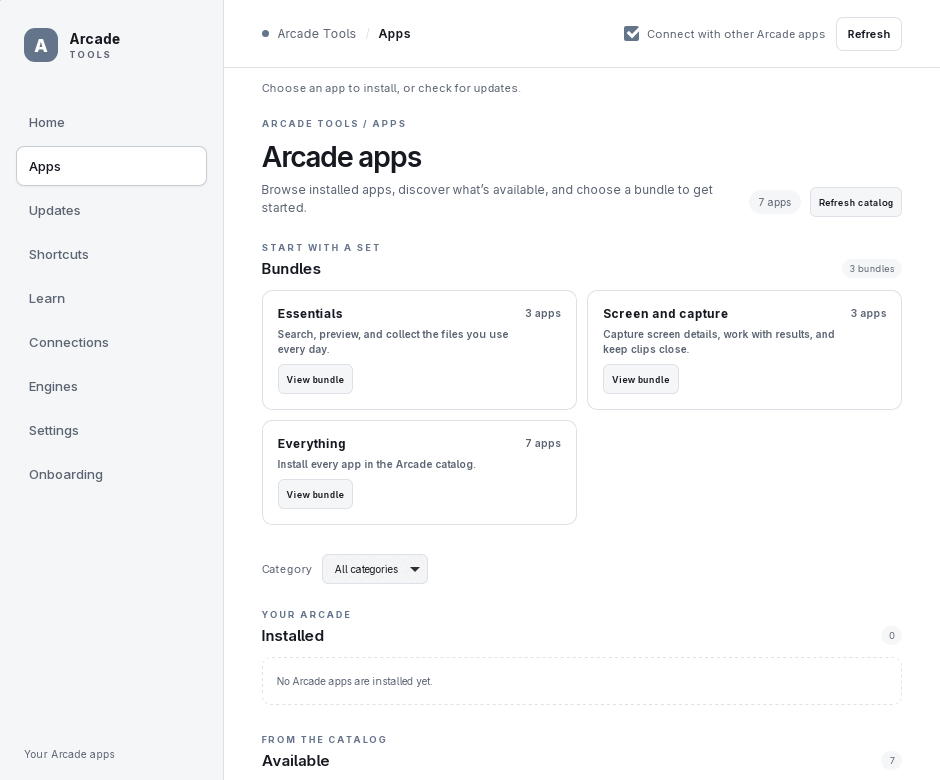

<p align="center">
  
</p>

<h1 align="center">Arcade Tools</h1>

<p align="center">The optional home for the Arcade apps.</p>

<p align="center">
  <a href="https://github.com/qa-p1/Arcade-tools/releases/latest"></a>
  <a href="https://github.com/qa-p1/Arcade-tools/actions/workflows/ci.yml"></a>
</p>

---

Arcade Tools is the optional home for Box, Lens, Look, Wheel, Clipboard, Find and Shelf. Browse the catalog, install bundles, adopt existing installations, update and roll back apps, host their tray menus, find shortcuts, and read guides without leaving Tools. **Tools is optional:** every app also works independently and can be installed by hand.

It runs on **Linux** (x86_64; X11 and Wayland), **Windows** (x64) and **macOS** (universal: Apple Silicon and Intel). Windows/macOS and non-Hyprland Wayland are checked in CI only, not yet on a real desktop.

<p align="center"></p>

## Download and install

Download the file for your system from [Releases](https://github.com/qa-p1/Arcade-tools/releases). Packages are per user.

| Platform | File | How to install |
|---|---|---|
| Linux x86_64 | `Arcade-Tools_<version>_amd64.AppImage` | Run it. The first run asks **Install Arcade Tools?** and installs to `~/Applications/Arcade`, with a launcher entry, icons and an `arcade-tools` command. |
| Windows x64 | `Arcade-Tools_<version>_x64-setup.exe` | Run Setup (NSIS). Installs for your user without admin into `%LOCALAPPDATA%\Programs\Arcade Tools`, adds a Start menu entry and an `arcade-tools.cmd` command in `%LOCALAPPDATA%\Arcade\bin` on your user PATH. Offers **Start at login** (on by default, because Tools hosts the apps' tray icons) and an unchecked **Desktop shortcut**. |
| macOS (universal) | `Arcade-Tools_<version>_universal.dmg` | Open the dmg and drag Arcade Tools to Applications. Started from the dmg or Downloads, it offers to move itself to Applications, records a receipt and adds an `arcade-tools` command link. |

- Scripted install: `arcade-tools --install --silent --no-launch` (Linux AppImage, or from the macOS app bundle). Windows: `/S`, with `/STARTATLOGIN=0|1` and `/DESKTOPSHORTCUT=0|1`.
- Builds are unsigned. On Windows, SmartScreen may warn: choose **More info → Run anyway**. On macOS the app is not notarized: Control-click or right-click it and choose **Open** the first time. Tools never removes quarantine or changes SmartScreen settings, and never changes shell profiles.
- If FUSE is missing on Linux, run the AppImage with `--appimage-extract-and-run`.

Version tags publish stable packages; other builds go to the rolling **nightly** prerelease. Each release includes `arcade-release.json` and `SHA256SUMS.txt`. See [Getting started](docs/user/getting-started.md).

## Features

- **Home:** installed versions, channels, uptime, memory, CPU, tray and Link state, with health checks that link to repair, adoption, engines and shortcut fixes.
- **Apps:** catalog details, bundles, install, update, repair, rollback, adoption, uninstall and app settings. Existing manual or self-installed apps can be adopted; development builds are left in place.
- **Updates:** compatibility holds, sanitized notes, history, and opt-in automatic updates per app that respect busy state and wait ten minutes since last use. Tools can also update itself.
- **Shortcuts:** Arcade globals, in-app keys, desktop binds and catalog sheets; rebind supported Arcade globals after conflict review.
- **Learn:** app guides, readable offline. **Connections** explains content flows between apps. **Engines** detects system programs and gives copyable install guidance.
- **Settings:** tray hosting, per-app opt-outs, update notifications, theme, diagnostics, backup/restore and **Uninstall everything**.
- **Safe by default:** Tools asks before installs, adoption, updates, uninstall, restore and shortcut changes. Downloads are restricted to trusted GitHub HTTPS hosts and verified against release SHA-256 and size metadata before execution. Diagnostics stay in a local redacted ZIP for you to attach to an issue.

More in [Features](docs/user/features.md).

## Works with other Arcade apps

Tools manages the other Arcade apps over peer-to-peer Arcade Link, pinned to **v0.3.0**. The apps never need Tools: each one works alone and connects to the others automatically.

- **Tray hosting:** Tools hosts each app's tray menu (Open, Settings, Restart, Quit and app extras) in one Arcade icon. Hosting is optional and each app can keep its own icon. Apps restore their own tray icon as soon as Tools quits, crashes or disconnects.
- **Quit all** asks once when an app is busy.
- **Install requests:** Tools exposes a confirmed install request to peers; it never installs silently from an incoming request.
- **Backup and restore** use each app's portable settings handoff; unsupported apps are listed as not included.

See [With other apps](docs/user/with-other-apps.md).

## Usage

The separate native `arcade-tools-overlay` ships in every package and starts on demand. Its default shortcut is **Super+/** on Linux, **Ctrl+Alt+/** on Windows, and **Ctrl+Option+/** on macOS. See the [shortcut reference](docs/user/shortcuts.md).

Closing the window destroys its webview. Tray hosting or the cheat-sheet shortcut keeps the native process resident; **Quit Arcade Tools** exits it and hands icons back to apps.

Start with **Onboarding**: choose apps or a bundle, review shortcut conflicts and tray/login preferences, then confirm installs.

### Command line

```sh
arcade-tools --version
arcade-tools --arcade-manifest
arcade-tools --background
arcade-tools --show-shortcuts
arcade-tools --install --silent --no-launch
arcade-tools --integration-status
arcade-tools --repair
arcade-tools --uninstall
arcade-tools --quit
```

## Settings and data

Backup includes Tools preferences, tray settings, shortcut labels and app channels, plus each app's portable settings. Restore reviews missing installations and settings before importing. **Never exported:** secrets, device identity, Clipboard history, Find's index and caches.

Tools reads desktop and Hyprland configuration read-only and stores shortcut labels in its own files.

## Uninstall

- **Linux and macOS:** `arcade-tools --uninstall`.
- **Windows:** **Settings → Apps → Installed apps**.
- **Uninstall everything** in Tools' Settings removes the apps Tools manages and then Tools.

Settings and data stay unless you choose to remove them. Removing Tools leaves your other Arcade apps working.

## Platform notes

- **Global shortcut:** Hyprland uses a runtime bind; X11, Windows and macOS use native registration; other Wayland desktops get a manual keyboard-settings hint.
- **Windows:** start at login toggles the Startup shortcut the setup program created and records it in the receipt, so updates keep your choice. The first update after adopting an app has no retained installer for rollback; Tools shows this before updating.
- Windows/macOS and non-Hyprland Wayland are verified in CI and isolated runs only. See [Status](docs/STATUS.md).

## Build from source

The native desktop uses Tauri 2's system webview and a Svelte 5 interface. The shell budget is 200 KB; Markdown is rendered and sanitized in Rust, and Learn/Connections load lazily. Docs snapshots are limited to 8 MB. The bundled catalog, shortcut sheets and ecosystem guide come from Arcade-catalog `main`; [snapshot provenance](resources/catalog-snapshot/README.md) records the source commit.

Use Rust **1.88** or newer, Node 24, and the Linux Tauri/Wayland/X11 libraries listed in [`.github/workflows/ci.yml`](.github/workflows/ci.yml). Keep a Link v0.3.0 checkout beside Tools for the isolated test runner. Temporary environments stay scoped to tests.

```sh
npm ci
npm run typecheck
npm run build
python3 scripts/ui-size.py
cargo fmt --all --check
CARGO_BUILD_JOBS=3 cargo clippy --workspace --all-targets --locked -- -D warnings
CARGO_HOME="$HOME/.cargo" python3 ../Arcade-link-wt-core/tools/e2e.py run -- cargo test --workspace --locked
cargo build --locked -p arcade-tools --features custom-protocol
cargo build --locked -p arcade-tools-overlay
CARGO_HOME="$HOME/.cargo" python3 ../Arcade-link-wt-core/tools/e2e.py run -- python3 scripts/tray-resident-e2e.py --check-budgets
python3 ../Arcade-link-wt-core/tools/e2e.py --only tools-hub
python3 scripts/verify-vendored.py
python3 scripts/test-docs-snapshot.py
```

CI checks the full workspace and frontend on Rust 1.88 for Linux, Windows and macOS, builds both binaries into actual installers, and runs disposable package smokes. Overlay render checks use private Xvfb. No live Arcade installation is changed by these tests.

## Documentation

- [User guide](docs/user/): [getting started](docs/user/getting-started.md), [features](docs/user/features.md), [shortcuts](docs/user/shortcuts.md), [FAQ](docs/user/faq.md), [troubleshooting](docs/user/troubleshooting.md), [with other apps](docs/user/with-other-apps.md)
- [Status](docs/STATUS.md)
- [Changelog](CHANGELOG.md)
- Shared sources and their hashes: [VENDORED](VENDORED)

## License

MIT.

---

<p align="center">
  Part of the <b>Arcade</b> suite:
  <a href="https://github.com/qa-p1/Arcade-Find">Find</a> ·
  <a href="https://github.com/qa-p1/Arcade-lens">Lens</a> ·
  <a href="https://github.com/qa-p1/Arcade-look">Look</a> ·
  <a href="https://github.com/qa-p1/Arcade-box">Box</a> ·
  <a href="https://github.com/qa-p1/Arcade-clipboard">Clipboard</a> ·
  <a href="https://github.com/qa-p1/Arcade-Shelf">Shelf</a> ·
  <a href="https://github.com/qa-p1/Arcade-wheel">Wheel</a> ·
  <a href="https://github.com/qa-p1/Arcade-tools">Tools</a> ·
  <a href="https://github.com/qa-p1/Arcade-catalog">Docs</a>
</p>
