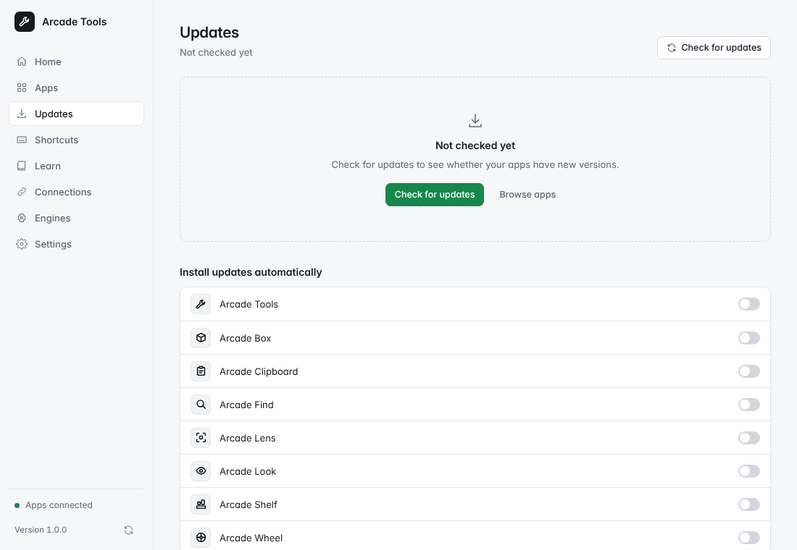

# Features

Home shows installed versions, channels, uptime, memory, CPU, tray and Link state. Metrics refresh every 10 seconds while Home is visible. Health checks link to repair, adoption, engines and shortcut fixes.

When an Arcade app (or Tools itself) crashes, it writes a report on this computer and Home shows **<App> crashed**. **View report** shows the whole report; from there you can **Copy report**, or **Open GitHub issue**, which opens a new issue in your browser filled in with the report for you to review and submit. **Dismiss** hides it. Nothing is sent anywhere unless you submit it.

Apps provides catalog details, bundles, install, update, repair, rollback, adoption, uninstall and app settings. Updates shows compatibility holds, sanitized notes, history and per-app automatic updates. Tools checks after 60 seconds, every six hours, and when an opened window has an hour-old check.

Automatic updates require each app's opt-in. Closed apps can update; running apps must report that they are not busy. When an app reports its last-used time, Tools waits ten minutes. Older apps without that timestamp use their busy state.

Tools can update its own standalone installation from Settings, including a Windows setup install or a macOS bundle dragged to Applications. Updates and rollbacks close and reopen Tools through a helper while your other apps keep running. Adoption also works when an app has only its install receipt.

On Windows, the first update after adoption has no retained installer for rollback. Tools shows this before updating. Later updates keep the previous installer in the cache.

Every app has a channel: **Stable** (the default) or **Nightly**, which gets each day's build and shows a Nightly badge. Switching an app back from Nightly to Stable backs up its data first. Tools trusts a release only through its signed manifest, which names the app, the channel and the version; a release whose manifest does not verify is not installed. When possible, Tools downloads only the parts of a file that changed since the installed version and checks each part; if anything does not match, it downloads the whole file instead, resuming after an interruption. A release the catalog marks as bad is no longer offered, and Tools offers to roll back to the previous version if you have it installed.

Shortcuts combines Arcade globals and in-app keys, desktop binds and catalog sheets. Rebind supported Arcade globals after conflict review. Hyprland configuration is read-only; the Tools overlay uses a runtime bind. The native overlay starts on demand and exits when dismissed.

Learn reads cached/versioned and bundled guides offline. Connections explains advertised content flows and opens each app’s own connected-app settings. Engines provides detection and copyable system-package guidance, plus a confirmed Link Tesseract download where supported.

Settings includes tray hosting, per-app opt-outs, update notifications, theme, diagnostics, backup/restore and uninstall everything. Closing the window destroys its webview while tray hosting or shortcuts remain enabled.
