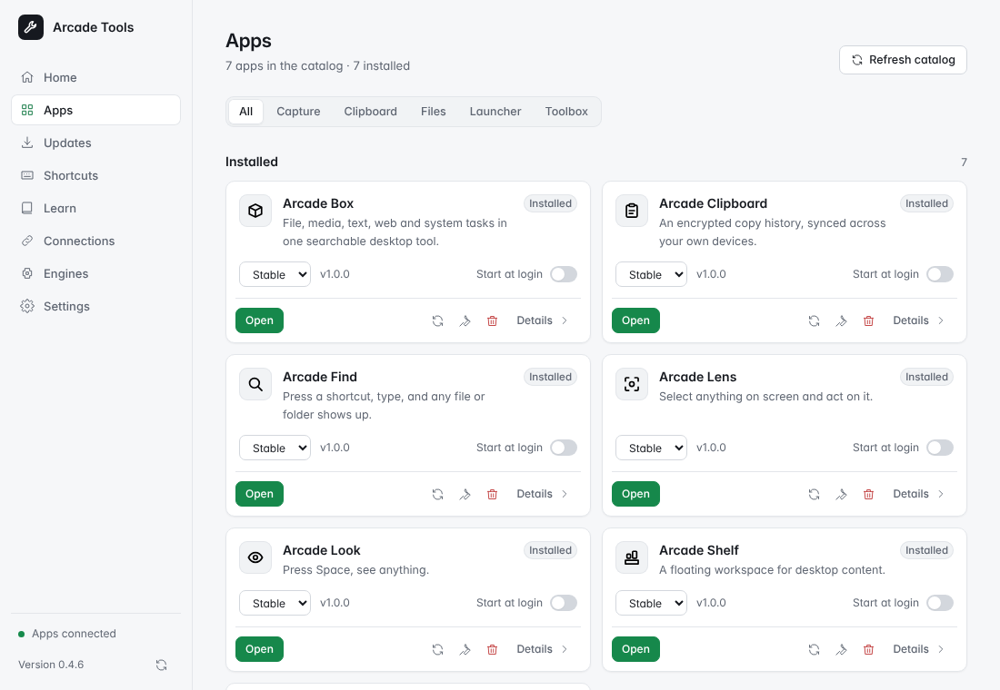

# Arcade Tools

Arcade Tools 0.2.0 is the optional home for Box, Lens, Look, Wheel, Clipboard, Find and Shelf. Install and update apps, host their tray icons, find shortcuts and read guides. Every app works independently.

## What Tools is best at

- **Installing and updating the whole family.** Pick a bundle or a single app, get updates with release notes, and roll back one step if a release misbehaves.
- **One tray icon instead of seven.** While Tools runs, it hosts every app's tray menu; quit it and each app shows its own icon again.
- **Finding a shortcut.** The shortcut center lists the global and in-app keys of every Arcade app, your desktop and common apps, flags conflicts and opens a cheat sheet over any window.

Start with [getting started](getting-started.md), then [features](features.md).

## Automatic repairs

While Tools runs, it checks Arcade-owned launchers and command links at startup and when integration files change. Routine repairs run locally without clicking Repair or enabling automatic updates. Existing customized launchers and disabled Start at login choices are kept. Tools backs up affected entries in its data folder before repairing them and reports anything it cannot fix safely. A missing application or Windows integration that needs the setup program still requires an explicit install or repair.
