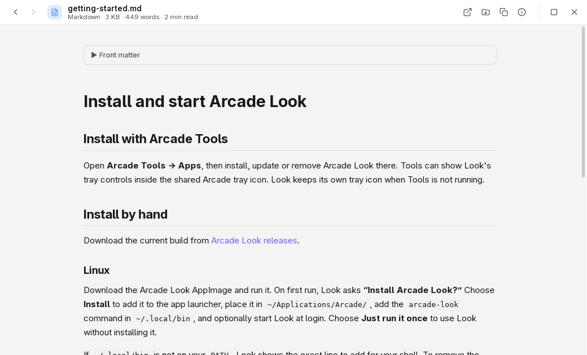

# Arcade Look

Arcade Look opens a fast preview for a file or folder without launching a full editor. It runs on Windows, macOS and Linux and can preview images, media, documents, code, archives, fonts, 3D models and more.

## What Look is best at

- **Previewing a file in place.** Use your file manager's preview shortcut, open a file with Look, or drop it on the window.
- **Moving through a folder quickly.** Step between files, open nested folders or archive entries, and use Back and Forward to retrace what you opened.
- **Sending a file to another Arcade app.** Run a compatible Box, Lens, Clipboard, Wheel or Shelf action from the Actions menu when that app is installed and connected.

Start with [installation and first run](getting-started.md), or browse [features](features.md), [shortcuts](shortcuts.md), [Arcade app connections](with-other-apps.md), [common questions](faq.md) and [troubleshooting](troubleshooting.md).
